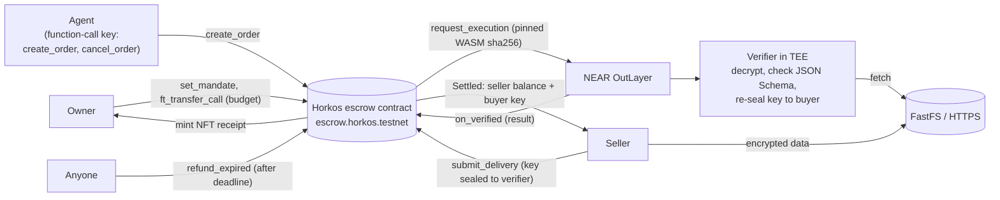
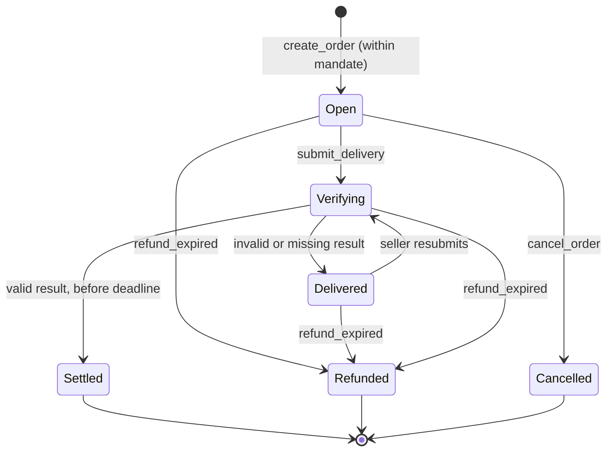
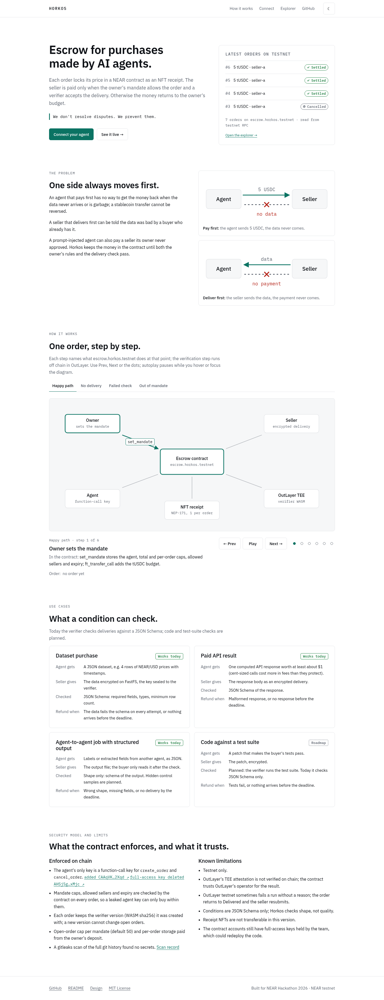
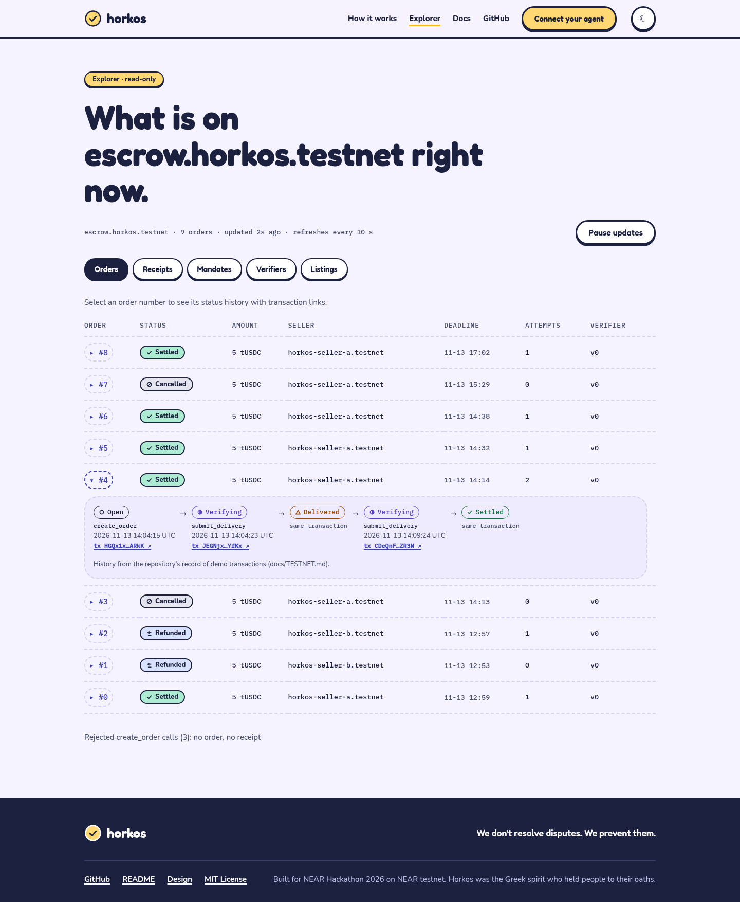

<p align="center"></p>

# Horkos

<p align="center"><em>Verify-then-pay for AI agents, native to NEAR.</em></p>

Horkos is an escrow contract on NEAR for purchases made by AI agents: each order locks its price in the contract as an NFT receipt, and the seller is paid only if the owner's spending mandate allows the order and a verifier confirms the delivery meets a machine-checkable condition; otherwise the money returns after the deadline.

**We don't resolve disputes. We prevent them.**

Built at NEAR HACKATHON (development window 19 Oct to 14 Nov 2026). Runs on NEAR testnet. License: MIT.

## Problem → solution

An agent's payment cannot be reversed: if it overspends, follows a prompt injection, or pays a seller who delivers nothing or garbage, the money is gone. Letting the buyer approve deliveries does not work either, because a buyer who already has the data can claim it was bad. Horkos puts the owner's limits (budget, per-order cap, allowed sellers, expiry) in the escrow contract itself, so a compromised agent cannot buy outside them. The seller delivers encrypted data, and a verifier running in NEAR OutLayer's TEE checks it against the listing's condition (a JSON Schema) before the buyer gets the key and the seller gets paid. If no valid delivery is verified before the deadline, anyone can trigger the refund.

## Architecture





Each order reaches exactly one final state (`Settled`, `Refunded` or `Cancelled`). Settlement only credits the seller's internal balance; the seller withdraws separately, so no token transfer happens inside the verification callback. Full design: [docs/architecture.md](docs/architecture.md); every method: [docs/contract-api.md](docs/contract-api.md); decisions: [docs/decisions.md](docs/decisions.md). All documents: [docs/README.md](docs/README.md).

## Quick start

Requirements: Linux or macOS, Rust ≥ 1.95 with the `wasm32-unknown-unknown` target, `cargo-near` 0.22, Node.js 20, git. The local NEAR node needs glibc ≥ 2.39; on older systems (for example Ubuntu 22.04) the scripts run it in Docker (`ubuntu:24.04`), so Docker is needed there. `setup.sh` installs the toolchain on Ubuntu/WSL.

### a) Local sandbox: all three demos, no accounts or keys

```bash
git clone https://github.com/iusserhat/horkos && cd horkos
contracts/scripts/test-sandbox.sh      # builds the contracts, downloads the local node, runs 7 integration tests
(cd sdk && npm ci)
cd demo && npm ci && npm run sandbox
```

`test-sandbox.sh` should end with `test result: ok. 7 passed`. `npm run sandbox` starts a local NEAR node, deploys the real Horkos and test-token contracts and `mock-outlayer` in `Worker` mode, and builds the real verifier natively. When the contract calls `request_execution`, the mock yields like OutLayer; a worker loop in `demo/sandbox.ts` runs the verifier on the request and resumes it with the verifier's output. You should see:

1. `order 0: Settled`, then the agent decrypts `{"symbol":"NEAR/USD","rows":[...]}`.
2. `valid=false, reason: schema: ... at /rows`, `order 1: Delivered`, the agent gets `nothing to open`, and after the 25 s window `refund_expired → order 1: Refunded`, 5 tUSDC back in the budget.
3. `create_order rejected: Smart contract panicked: Seller not allowed by mandate`, budget unchanged.

Not real in the sandbox: the TEE and OutLayer's operator (the worker is a local loop), HTTPS hosting (files are `file://` URLs), and the market data (the sandbox stays offline and delivers fixed sample prices).

### b) Testnet demos (real OutLayer)

The scripts in `demo/` sign with the demo accounts' keys, which only the team has, so they cannot be re-run as-is; anyone can inspect the results. Accounts: owner `horkos-owner.testnet`, agent `horkos-agent.testnet`, sellers `horkos-seller-a/b/c.testnet`, contract `escrow.horkos.testnet`, token `tusdc.horkos.testnet`.

- **Demo 1, good delivery → Settled.** Order 0: [`create_order`](https://explorer.testnet.near.org/transactions/92QVpcmFUQbxpYYV32sqR9CKdnxnN1n9H6VtH6KbLmzA), seller A's [`submit_delivery`](https://explorer.testnet.near.org/transactions/DgGzhbkGBEMHGG9duhFSQHgTKsXpxi9NgngEMb1BLAoD): OutLayer ran the verifier, `on_verified` settled the order, and the agent decrypted the JSON. Re-run on 13 Nov 14:22 UTC with the rotated agent key: order 5, [`create_order`](https://explorer.testnet.near.org/transactions/5jdfoCPv37ayyLefChhvRqLrnFGKEsNdsQRgHmnzY95), [`submit_delivery`](https://explorer.testnet.near.org/transactions/CbL9cC4uEvV8s5MjMaTKqNrvr6f743FcQoyHHmE2gb5S) → `Settled`. With live CoinGecko data on 13 Nov 16:52 UTC: order 8, [`create_order`](https://explorer.testnet.near.org/transactions/83XaoQwthAgLEiJViT1hwXQEwfGiZunFssoCCFtkRWyX), [`submit_delivery`](https://explorer.testnet.near.org/transactions/C97q52MF6UcN4G8M3EAG5JoY4Cpa3Z4kQrNqUB7UN4WB) → `Settled`; the decrypted prices matched CoinGecko's (`docs/testnet.md`).
- **Demo 2, bad delivery → Refunded.** Order 2: [`create_order`](https://explorer.testnet.near.org/transactions/4zL12Bg9TNRgVtXyyh7KfBrCRcQsa4bbuap2b3jd6rL6), seller B's [`submit_delivery`](https://explorer.testnet.near.org/transactions/HgPppJUNPThmUDfEpDxhtTnFeZZDVktzggR4thvhE2yj) failed the schema (order `Delivered`, no key for the buyer), then [`refund_expired`](https://explorer.testnet.near.org/transactions/7PkEjmE3LJfQeH3Ko5KvNXT4Xm9EFzF3Qpg84xXssfC5) after the deadline.
- **Demo 3, hijacked agent → rejected.** A listing text tells the agent to buy a 500 tUSDC feed from seller C. The agent's [`create_order`](https://explorer.testnet.near.org/transactions/82LUfji2HUSR9swkzvYVYYVJe31dedkrrj7Jicc7AXWt) fails with `Seller not allowed by mandate`; budget and open orders unchanged.

**Where seller A's data comes from.** In the testnet demo, seller A fulfils orders with live NEAR/USD prices from CoinGecko's free public API (`demo/sellers/coingecko.ts`, no key, no fallback: if CoinGecko does not answer, nothing is delivered). Price data by CoinGecko. Horkos does not pay CoinGecko and CoinGecko is not a Horkos seller; it is seller A's data source. We do not use x402 in this demo. Reselling a provider's data commercially would need that provider's permission. The hosted seller A that serves judges' orders (`demo/sellers/hosted.ts`, on Render) uses the same CoinGecko endpoint and falls back to Coinbase's public NEAR-USD API (no key) when CoinGecko rate-limits its shared cloud IP; Horkos has no relationship with Coinbase either. The local sandbox (Quick start a) uses fixed sample prices.

Check the orders yourself (needs `near-cli-rs`):

```bash
near contract call-function as-read-only escrow.horkos.testnet get_order json-args '{"order_id":"0"}' network-config testnet now
near contract call-function as-read-only escrow.horkos.testnet get_order json-args '{"order_id":"2"}' network-config testnet now
near contract call-function as-read-only escrow.horkos.testnet nft_token json-args '{"token_id":"0"}' network-config testnet now
```

You should see `"status": "Settled"` for order 0, `"status": "Refunded"` for order 2, and NFT receipt `0` owned by `horkos-owner.testnet` with the order summary in its metadata. All transaction ids: `docs/testnet.md`.

### c) MCP server: let Claude buy within the mandate (testnet)

The server (`mcp/`, stdio) gives an agent five tools: `horkos_search_listings`, `horkos_create_order`, `horkos_get_order`, `horkos_open_delivery`, `horkos_cancel_order`. It signs as the agent, so it needs the agent's function-call key (the team has it; it can only call `create_order` / `cancel_order` on the escrow). You can point it at your own deployment with `HORKOS_AGENT`, `HORKOS_OWNER`, `HORKOS_CONTRACT` and `HORKOS_AGENT_KEY` (see the header of `mcp/server.ts`).

```bash
cd mcp && npm ci
# Claude Code:
claude mcp add horkos -- "$PWD/node_modules/.bin/tsx" "$PWD/server.ts"
# Claude Desktop (claude_desktop_config.json):
#   "mcpServers": { "horkos": { "command": "/abs/path/horkos/mcp/node_modules/.bin/tsx", "args": ["/abs/path/horkos/mcp/server.ts"] } }
```

For deliveries to happen, run a seller in another terminal (`cd demo && npm run seller -- a`). Then ask: *"Find a NEAR/USD price feed and buy it without spending more than 10 tUSDC, then show me the data."* You should see `horkos_search_listings` (listing 0 at 5 tUSDC, `seller_allowed_by_mandate: true`), `horkos_create_order` → `Open`, `horkos_get_order` → `Settled`, and `horkos_open_delivery` returning `{"symbol":"NEAR/USD","rows":[...]}`. Checked on 13 Nov with Claude Code (`claude -p`, model Sonnet): order 6 went `Open → Verifying → Settled` and the data opened. Asked to buy the "premium" listing (500 tUSDC, seller C), Claude declined on its own: it flagged the listing text as an injection and saw `seller_allowed_by_mandate: false`. The contract does not depend on that: when `create_order` is sent anyway (`npx tsx smoke.ts inject`, or demo 3), it fails with `Seller not allowed by mandate`. Listing descriptions are off-chain text in `mcp/catalog.testnet.json`; listing 2's is a deliberate prompt injection. MCP orders on testnet: 3 (cancelled), 4 and 6 (settled); see `docs/testnet.md`.

Without an MCP client, `cd mcp && npx tsx smoke.ts inject` drives the same server over stdio (`buy`, `cancel` and `open N` spend or move testnet tUSDC).

## Website (`web/`)

Live site: https://horkos-escrow.netlify.app (Netlify, deployed by hand from `web/dist`; no git-triggered deploys).

A static site that explains Horkos, guides agent setup and shows the contract's live state. Run it locally:

```bash
cd web && npm ci && npm run build && npm run preview     # → http://localhost:4173
```

- **Home:** the order flow as an animated diagram (happy path, no delivery, failed check, out of mandate), the NFT receipt in each status, use cases, which NEAR feature does what, the security model and limits. The "Orders on testnet" panel reads the contract over RPC.
- **Connect:** a config generator for Claude Code, Claude Desktop, Cursor and other MCP clients (account names and paths only; it never asks for a key), near-cli commands for the mandate and the agent's function-call key, the five tools with request/response pairs captured from testnet, two recorded Claude Code conversations, an SDK example and troubleshooting.
- **Explorer:** orders, receipts, mandates, verifier versions and listings from `escrow.horkos.testnet` view methods, refreshed every 10 s. Order history comes from the repo's record of demo transactions (`docs/testnet.md`, copied at build time), otherwise from the NearBlocks testnet API checked against RPC; if neither works it is rebuilt from the order's fields and says so. The contract has no view that lists mandates, so the explorer shows owners that have orders and looks up others by name.

Built with Vite and TypeScript, no UI framework; fonts Fredoka, Nunito and IBM Plex Mono, self-hosted (no Google Fonts requests). Lighthouse 13.6 on the local build (13 Nov 2026), performance / accessibility / best practices / SEO: home 98/100/100/100 mobile, 100/100/100/100 desktop; connect, explorer and market 100/100/100/100 on both. Live home page on Netlify (14 Nov 2026): 95/100/100/100 mobile, 100/100/100/100 desktop.

| Home | Connect | Explorer |
| --- | --- | --- |
|  |  |  |

More (market page, 390 px, dark theme, each explorer tab): `docs/screenshots/`.

## OutLayer on testnet: failed runs

Verification runs on OutLayer testnet, which sometimes times out; the hosted seller retries automatically for up to 30 minutes (listings 4 and 5 have a 30-minute window); if it still fails, the order refunds in full. Measurements and transactions: `docs/testnet.md`.

OutLayer testnet sometimes fails a verification run without giving a reason. On 13 Nov 2026 every testnet execution failed from about 12:00 UTC (still failing at 12:16, working again by 12:49) with "Execution request not found"; later that day one of our runs (order 4, OutLayer request 38907) failed the same way while other runs worked. In that case the callback carries no result, and the contract moves the order from `Verifying` back to `Delivered`. The seller calls `submit_delivery` again and the order settles (order 4 settled on the second attempt). If the deadline passes first, `refund_expired` returns the funds. The money is never stuck in the contract. If OutLayer does not answer at all, `npm run sandbox` (Quick start a) shows the same flow locally. This path is also covered by the sandbox test `invalid_and_null_results_return_to_delivered_then_retry_settles`.

## Security model

- **Agent key.** `horkos-agent.testnet` has one key: a function-call key that can only call `create_order` and `cancel_order` on `escrow.horkos.testnet` (5 NEAR gas allowance). Rotated on 13 Nov 2026: new key [added](https://explorer.testnet.near.org/transactions/CAAqVKNCBhdDUG3dk8Pir72nUiH6ZXQgVgGJAQPD2Xqd), old function-call key [deleted](https://explorer.testnet.near.org/transactions/DDXYxnKkkLwdAwmbjtu6YMMcuc5PswzWDHhsg2g3Q7ET), full-access key [deleted](https://explorer.testnet.near.org/transactions/AHSj5g6T8hf8un6j3PdeVhHn3SjAWgcu13AD6uVqxMjc). Check: `near account list-keys horkos-agent.testnet network-config testnet now` shows a single function-call key.
- **Mandate limits are enforced by the contract.** On every `create_order` the contract checks that the caller is the mandate's agent, the mandate is active and not expired, the seller is on the allowed list, and the price fits the per-order cap, the total cap and the budget. A leaked agent key can only buy within the mandate.
- **Verifier version is pinned per order.** Each order keeps the verifier version (WASM sha256, OutLayer account, public key) that existed when it was created. The admin can publish new versions but cannot change the one an open order uses. Only the result of the contract's own OutLayer call is accepted (private callback, matched to the order and attempt).
- **Open-order cap and storage deposit.** Each mandate has an open-order cap (default 50, at most 100). Each order's storage is paid from the owner's storage deposit, so order spam cannot drain the contract.
- **Repository secret scan.** gitleaks 8.30.1 (official release, checksum verified) over the full git history found no secrets; the one hit was a false positive in `verifier/Cargo.lock`. Details: `docs/security.md`.

## Known limitations

- **Testnet only.** No mainnet deployment.
- **OutLayer's TEE attestation is not verified on chain.** OutLayer's callback carries only the program's output, with no signature or quote. The operator account (`worker.outlayer.testnet`) also has full-access keys, so the contract trusts OutLayer's operator. The attestation can be checked off-chain afterwards. Details: `spikes/outlayer/REPORT.md`, `docs/internal/outlayer-question.md`.
- **The verifier's public key** is published by the admin with each verifier version; the contract does not check that it came from the TEE. (On testnet it was printed by the verifier inside OutLayer, tx `5iWyLC1TVjd7v4CKSDU4yggATB4x4g42TJs4xJAZRtRH`.)
- **Receipt NFTs are not transferable** in this version.
- **Conditions are JSON Schema only.** Horkos checks that a delivery meets the seller's published schema, not that the data is good.
- **Admin powers.** The admin can add verifier versions but cannot affect existing orders. However, the contract accounts (`escrow.horkos.testnet`, `tusdc.horkos.testnet`) still have full-access keys held by the team, and whoever holds them can redeploy the code.
- **Costs.** Each order charges about 1,517 bytes of storage (≈ 0.0152 NEAR) to the owner's storage deposit; the seller pays OutLayer's fee (≈ 0.0015 NEAR charged per run on testnet) for each verification attempt.
- If a verification callback fails for a reason other than the result (for example gas), the order stays `Verifying` until the deadline, then refunds.

## Existing approaches

Other NEAR HACKATHON projects listed on [NEAR Hunt](https://nearhunt.xyz) work on related problems. Each line summarizes the project's own NEAR Hunt description; we have not run them.

- [PayPerCall on NEAR](https://nearhunt.xyz/p/8ce1e3a2-1bf0-4dc0-aeb3-0981afda5c60): escrows each API payment by an agent; a verified answer pays the provider, no answer refunds the agent.
- [Handoff](https://nearhunt.xyz/p/af71df2a-6661-459d-a7a8-39a43a411270): buyer escrows, the worker delivers an artifact and its hash, a machine checks the work, then money moves.
- [DeadDrop](https://nearhunt.xyz/p/14c70946-d8de-4fed-8fc6-739886447220): sells encrypted files; payment goes into escrow, the key is sealed to the buyer's public key, the seller is paid only on delivery.
- [Inari](https://nearhunt.xyz/p/1a6c7171-09e2-48e8-85b0-036de148a63d): pay-per-call escrow where a worker signs the result and the contract pays the seller or lets the buyer claim a refund.
- [ProofRail](https://nearhunt.xyz/p/eef74cf6-0cfe-433f-9a0c-0d5b24b5532f): tests are set up front; passing pays out of escrow, failing refunds.
- [Nearsay](https://nearhunt.xyz/p/62d32e18-80a2-4d2b-95be-0d4c99fb783b): escrow with hardware-backed verification of an agent's work, team payouts and refunds.
- [SETTLENEAR](https://nearhunt.xyz/p/c94136e5-eaeb-4cb1-94ea-a71cfe5f11d0): an escrow, work-verification and payment protocol for humans and AI agents.
- [Emporium](https://nearhunt.xyz/p/d9eafab3-18e9-4c8f-9676-143d13df9289): lets an agent sell its skills per job, paid in USDC on NEAR once the work is delivered.
- [GRAM-402](https://nearhunt.xyz/p/dc953975-7c41-474c-b44b-6cac8149f04e): a contract mandate (budget, cap, merchants) through which an agent pays HTTP 402 requests.
- [NearGuard](https://nearhunt.xyz/p/916f8fba-c86f-47b0-bcf0-1a70f3b4cf6d) and [SpendGuard](https://nearhunt.xyz/p/fde9ac19-13da-4b0f-84e7-8e9bc19c63ef): contracts that check each agent payment against owner-set caps and allowlists.
- [Lot Passport](https://nearhunt.xyz/p/73623146-ea42-4664-a0bf-3fea21c1dc82): locks USDC in an NFT until an inspector checks the goods; pass pays the supplier, fail refunds.
- [Payrouta](https://nearhunt.xyz/p/15459740-1659-43d3-8e67-fda5b9967c52): a checkout widget where customers or agents pay with NEAR Intents from any wallet, chain or token.

What Horkos does differently, concretely: the spending mandate and the escrow are the same contract, so the limit check and the locking of funds happen in one `create_order` call; the buyer cannot read the data before the verifier accepts it, and the seller cannot be paid without that acceptance; the check runs in OutLayer's TEE against a condition fixed when the listing was created, with the verifier WASM pinned per order; every order is an NFT receipt whose metadata tracks its status; and the only refund path is a deadline anyone can trigger, so there is no dispute step.

## Run the tests

```bash
cd contracts && cargo test -p horkos -p test-token     # 101 + 4 unit tests
cd .. && contracts/scripts/test-sandbox.sh              # 7 integration tests on a local node
(cd sdk && npm ci && npm test)                          # 6 SDK tests (after test-sandbox.sh)
(cd verifier && cargo test)                             # 15 verifier tests
(cd sdk && npm run test:verifier)                       # 5 end-to-end tests: SDK-built deliveries through the native verifier
(cd mcp && npm ci && npm run typecheck)                 # MCP server type check
(cd gateway && npm ci && npm test && npm run test:sandbox)  # 17 gateway unit tests + 2 on a local node
```

Each should report no failures. The unit tests include per-order and total limit violations, a seller outside the mandate, double refund, an admin swapping the verifier for open orders, a valid result arriving after the deadline, a late callback after a refund, and the storage-deposit bound on create/cancel loops. The integration tests print the gas the callbacks burn (for example `GAS on_verified (settle): 2.40 Tgas`) and fail if any path uses more than half of what the contract attaches.

## Documentation

Start at [docs/README.md](docs/README.md): architecture, contract API, SDK, MCP, gateway, faucet, verifier, testnet evidence, security, decisions, FAQ. Changes: [CHANGELOG.md](CHANGELOG.md). Reporting a vulnerability: [SECURITY.md](SECURITY.md).

## Repository

```
contracts/horkos/            escrow contract (Rust, near-sdk 5.30)
contracts/test-token/        testnet NEP-141 token "tUSDC" (6 decimals)
contracts/faucet/            testnet tUSDC faucet (20 per account per day, capped)
contracts/mock-outlayer/     test-only stand-in for OutLayer (Worker mode yields until resolved, like OutLayer)
contracts/integration-tests/ sandbox tests (near-workspaces)
contracts/scripts/           build, sandbox test runner, Docker wrapper for the local node
verifier/                    delivery verifier (Rust, WASI P2) that runs in OutLayer's TEE
sdk/                         TypeScript SDK: HorkosAgent, HorkosSeller, HorkosOwner
mcp/                         MCP server (stdio), 5 tools, NEAR testnet
gateway/                     seller gateway: serve a listing from a JSON API by config
web/                         static site: product page, MCP guide, live explorer (Vite + TypeScript)
demo/                        seller services, testnet scenarios, local sandbox demo
spikes/outlayer/             OutLayer experiment: WASI schema checker, probe contract, report
docs/                        documentation (index: docs/README.md); docs/tr Turkish originals, docs/internal working notes
render.yaml                  Render blueprint for the hosted testnet seller A
```

## Roadmap

- Mainnet deployment, with the contract accounts' full-access keys removed or upgrades behind a DAO or timelock.
- Cross-chain payment and refund through NEAR Intents.
- Richer conditions: test suites and recomputable outputs, not only JSON Schema.
- Transferable receipts.
- Browser wallet: roadmap. A web page where the owner sets up the mandate and buys with a NEAR wallet (today: SDK, MCP or near-cli). `web/src/lib/wallet.ts` (NEAR Wallet Selector 10.1.4, Meteor and MyNearWallet, testnet) is in the repo but no page uses it: on 13 Nov a real connect-and-sign flow could not be checked (MyNearWallet has stopped new app connections and approvals since 1 Nov; Meteor's web wallet blocks automated browsers), and nothing unchecked is claimed.
- On-chain verification of the verifier's TEE attestation, once OutLayer exposes it to contracts.

## Libraries, templates and AI use

Libraries (exact versions are pinned in `Cargo.lock` / `package-lock.json`):
- Contracts (Rust): `near-sdk` 5.30.0, `near-contract-standards` 5.30.0, `near-workspaces` 0.24.0 (tests), `tokio`, `serde_json`, `anyhow`. Toolchain: `cargo-near` 0.22.0, near-sandbox / nearcore 2.14.0 (tests).
- Verifier (Rust): `crypto_box` 0.9.1, `chacha20poly1305` 0.10.1, `jsonschema` 0.59.0, `sha2`, `base64`, `hex`, `serde_json`, `wasi-http-client` 0.2.1 (WASM build only).
- TypeScript: `near-api-js` 7.3.1, `libsodium-wrappers` 0.8.4 (all encryption), `typescript` 7.0.2, `tsx` 4.23.15.
- MCP server: `@modelcontextprotocol/sdk` 1.32.2, `zod` 3.25.76.
- Website: `vite` 8.3.5, `typescript` 7.0.2, `@fontsource/fredoka`, `@fontsource/nunito`, `@fontsource/ibm-plex-mono` and `@fontsource/ibm-plex-sans` 5.3.0 (SIL OFL fonts); dev only: `playwright` 1.64.1 (screenshots), Lighthouse 13.6.0 via npx (scores).
- Docker image `ubuntu:24.04`, used only to run the local node on hosts with an older glibc.

Templates and borrowed formats:
- `contracts/test-token` follows the fungible-token example in near-sdk-rs (v5.30.0) and adds an owner-only `mint`.
- The FastFS upload format in `sdk/src/storage.ts` follows `out-layer/outlayer-cli` (`src/commands/upload.rs`).

AI use: the code, tests, scripts and documentation drafts were written with Claude Code (Anthropic, model Claude Opus 5.5) under the direction of the team member, who set the design, made the decisions recorded in `docs/decisions.md`, and reviewed the results. Commits made this way carry a `Co-Authored-By: Claude` trailer.

## License

MIT, see `LICENSE`.
