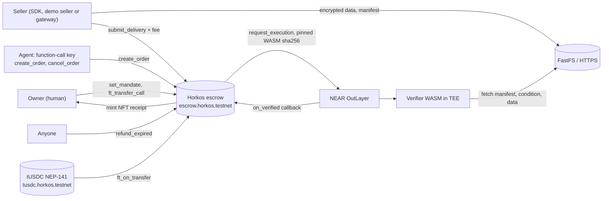
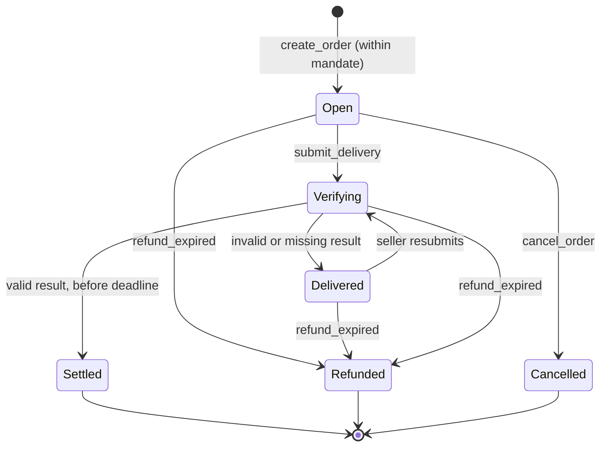
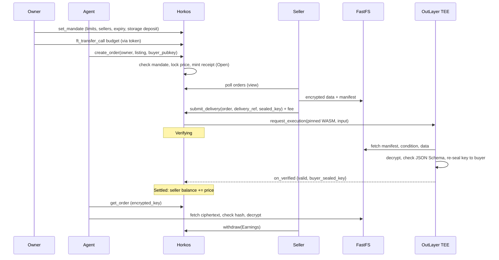
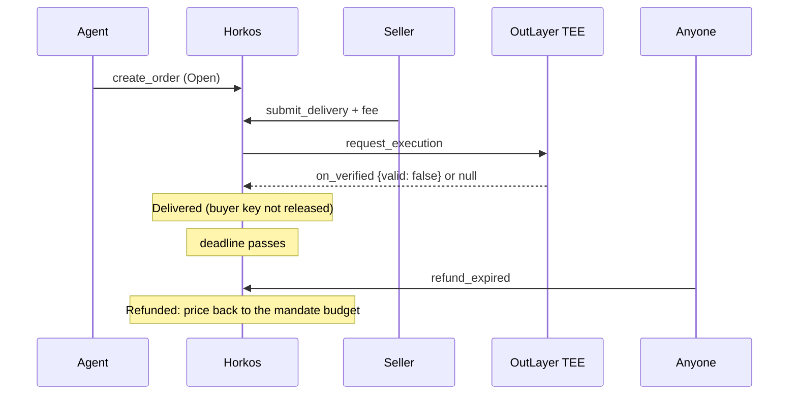
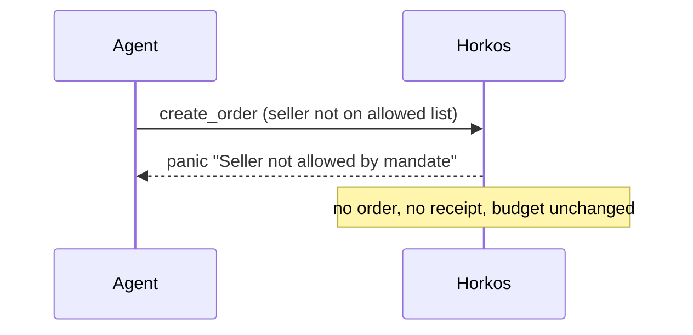

# Architecture

Horkos is an escrow protocol for purchases made by AI agents on NEAR. Each purchase is an order whose price is locked in one contract and recorded as an NFT receipt. The seller is paid only when the delivery passes a machine-checkable condition, checked by a verifier that runs in NEAR OutLayer's TEE. Otherwise the money returns to the buyer's budget after the deadline. Principle: we don't resolve disputes, we prevent them.

This is the English, current version of the original Turkish design ([tr/DESIGN.md](tr/DESIGN.md), 28 Oct 2026). Method-level detail: [contract-api.md](contract-api.md). Reasons for each choice: [decisions.md](decisions.md). Threats and limits: [security.md](security.md).

## Problem

Agents can pay, but nothing decides what happens when a payment goes wrong.

1. **Irreversible payment.** Stablecoin payments settle in seconds; there is no chargeback and no standard refund path.
2. **Unclear authority.** When an agent exceeds what it was allowed to do, there is no on-chain record of the limit it broke.
3. **Compromised agents.** A prompt-injected agent spends whatever its key can reach.
4. **Seller fraud.** Take payment and never deliver, or deliver useless data.
5. **Buyer fraud.** Receive the data, then claim it was bad. If the buyer is the one who checks the delivery, lying pays (the fair-exchange problem).

## Solution

| Mechanism | What it does | Problem it closes |
| --- | --- | --- |
| On-chain mandate | The budget sits in the contract; limits, allowed sellers and expiry are checked there. The agent's key can only open and cancel orders. | Unclear authority, compromised agent |
| Escrow | The price moves to the order, not to the seller | Seller fraud |
| NFT receipt | Record of who bought what, for how much, under which mandate, in which state | Missing record |
| Fair exchange | Encrypted delivery; payment and the buyer's key are released in the same callback | Buyer fraud |
| Timeout refund | After the deadline anyone can return the money | Seller who never delivers |

The buyer cannot read the data before the verifier accepts it, so "I got it but it's broken" cannot happen. For machine-checkable goods the only refund path is the timeout.

## Components

| Component | Path | Role |
| --- | --- | --- |
| Escrow contract | `contracts/horkos` | Mandates, listings, orders, receipts, verification callback, balances |
| Test token | `contracts/test-token` | tUSDC, NEP-141, 6 decimals, testnet only |
| Faucet | `contracts/faucet` | 20 tUSDC per account per 24 h ([faucet.md](faucet.md)) |
| Verifier | `verifier/` | Rust, WASI P2; runs in OutLayer's TEE ([verifier.md](verifier.md)) |
| SDK | `sdk/` | `HorkosOwner`, `HorkosAgent`, `HorkosSeller`, crypto, FastFS store ([sdk.md](sdk.md)) |
| MCP server | `mcp/` | Five tools for MCP agents ([mcp.md](mcp.md)) |
| Gateway | `gateway/` | Serves a listing from a JSON API by config ([gateway.md](gateway.md)) |
| Demo | `demo/` | Seller services, testnet scenarios, local sandbox |
| Website | `web/` | Product page, guides, live explorer |
| Mock OutLayer | `contracts/mock-outlayer` | Test-only stand-in for OutLayer |

## Order state machine

Every order reaches exactly one final state. `Settled` credits the seller's internal balance and stores the buyer's sealed key; no token moves inside the callback. `Delivered` means the last attempt did not produce a valid result; the seller may resubmit until the deadline. `refund_expired` works from `Open`, `Verifying` and `Delivered` once the deadline has passed, and a verification result that arrives later is ignored.

## Sequences

### Purchase that settles

### Delivery that fails, then refund

### Order outside the mandate

## Delivery protocol

All cryptography is libsodium (`sdk/src/crypto.ts`).

1. The seller encrypts the data with a random key `K` (XChaCha20-Poly1305, `nonce || ciphertext`) and stores the ciphertext at a content-addressed URL (FastFS: path = sha256).
2. The seller publishes a manifest `{v: 1, order_id, data_url, condition_url}`; `delivery_ref` is the manifest URL. `condition_url` is the listing's JSON Schema, whose sha256 must equal the listing's `condition_hash`.
3. The seller seals `K || sha256(ciphertext)` (64 bytes) to the verifier's public key (sealed box) and calls `submit_delivery(order_id, delivery_ref, sealed_key)` with OutLayer's fee attached.
4. The contract calls `request_execution` with input `{order_id, attempt, delivery_ref, sealed_key, condition_hash, buyer_pubkey}`. `buyer_pubkey` and `condition_hash` come from the order and listing records, never from the seller.
5. The verifier (in the TEE) checks the caller, opens the sealed payload, fetches manifest, condition and ciphertext, checks both hashes, decrypts, validates the JSON Schema and, if it passes, seals the same 64 bytes to `buyer_pubkey`.
6. `on_verified` settles. The buyer opens `encrypted_key`, downloads the ciphertext, checks its hash against the sealed hash (so a seller cannot swap the file after verification) and decrypts.

## Trust model

The contract does not verify a TEE attestation or signature: OutLayer's callback carries only the program output (or `null` on failure). The contract relies on two things: the result arrives through the `#[private]` callback of its own `request_execution` call, and the WASM that runs is pinned by sha256 in the verifier version the order was created with. OutLayer's operator is trusted to deliver that output; its operator account holds full-access keys. The TEE run can be checked off-chain afterwards. Full list: [security.md](security.md).

## Fees and storage

| Item | Who pays | Amount (testnet, measured) |
| --- | --- | --- |
| Order record + receipt + metadata slack | Owner's storage deposit, at `create_order` | 869 bytes ≈ 0.0087 NEAR, kept |
| Delivery and settlement reserve (`delivery_ref`, `encrypted_key`, seller balance entry) | Owner's storage deposit, at `create_order` | 648 bytes ≈ 0.0065 NEAR; returned if the order closes with no delivery |
| Total per order | Owner | 1,517 bytes ≈ 0.0152 NEAR |
| Verification run | Seller, attached to `submit_delivery` | `min_fee` 0.01 NEAR attached; OutLayer charged ≈ 0.0015 NEAR per run and refunded the rest |
| Listing record | Seller, attached to `register_listing` | Excess refunded |
| Verifier version | Admin, attached to `set_verifier` | Excess refunded |

A mandate with 50 open orders needs about 0.76 NEAR of storage deposit. `submit_delivery` and `on_verified` never need a new storage payment.

## Integration layers

| Layer | Used by | Status |
| --- | --- | --- |
| Contract | Everyone | Deployed on testnet |
| TypeScript SDK | Agent and seller developers | In repo, tested |
| MCP server | MCP agents (Claude Code, Claude Desktop, Cursor) | In repo, used on testnet |
| Gateway | Sellers with an existing JSON API | In repo, used on testnet |
| Website | Humans | https://horkos-escrow.netlify.app |
| Browser wallet page, x402 bridge, NEP proposal | Ecosystem | Roadmap, not built |

## Use cases

Fits: data sets (schema, row count, freshness), market data feeds, labelling with hidden control samples, compute jobs with recomputable samples, code work with a test suite, vulnerability reports that trigger a PoC. Today's verifier checks JSON Schema only.

Does not fit: cent-sized per-call API payments, subjective quality, physical goods, services spread over time. Target order size is roughly $1 to a few hundred dollars.
